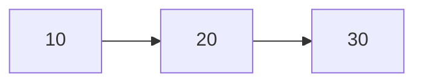

**ADT** - Abstract Data Type
- ADTs are conceptual models that define a set of operations and behaviors for a data structure

## List ADT

**List ADT Goals**
- `insert` - Done via front/back, at index, or at pointer
- `delete` - Done via front/back, at index, or at pointer
- `getData` - Done via front/back, at index or at pointer
- `isEmpty` 
- `size`
- **Store any necessary constructor, destructors, copy constructors, etc. so that it behaves like any basic variable**

The goal is to have every data structure behave like a fancy interface, but at a fundamental level act exactly the same as a basic data type! They should also behave like **templates** so that they can store anything (integers, pictures, imaginary numbers, etc.). We just want one generic data structure!

This is done via generics and templates!

There are two main implementations of a list
1. vector or array (store a list by allocating a chunk of data!)
2. linked list (allocate every element in a list separately and link them together via pointers or references)

Data structures can be best shown as diagrams, like the example below, which shows a linked list



In this example (shown above), the **head** is the **first node** in the linked list, and is in fact a **pointer** that points to the first node in the linked list. 

Similarly, the **tail** is the **last node** in the linked list and it points to **nothing** (null pointer)!

This means that our List ADT must contain
- `head` - a pointer to a `ListNode`

Intuitively this also shows that the linked list that contains several nodes, which begin with the value `10`, where then points to the next node of the linked list with value `20`, and so on
- From a C++ standpoint, this means that our List ADT must chain nodes together via **pointers** 
	- Each node contain its own data along with a **pointer** that points to the next node in the List!

This is shown in the code below. This code represents a generic `ListNode` instance of a `List`. In this `ListNode` representation, each `ListNode` holds a generic type of data notated as `T`. 

Additionally, there is a pointer to the next `ListNode` in the List along with a copy constructor that can be used to copy data into the List!

```
// List.h

#pragma once

struct ListNode {
	T data;
	ListNode* next;
	ListNode(const T& data) : data(data), next(nullptr) { }
}
```

Going back to the generic List ADT type, we can construct a class type for list that encapsulates this `ListNode` struct from the code above (because we know only the List type will use it!). This is shown in the code below!

Additionally, the following functionalities must also be achieved in the List ADT, as stated earlier

```
// List.h

#pragma once

class List {
public:
	void insertAtFront(const T&)
private: 
	struct ListNode {
		T data;
		ListNode* next;
		ListNode(const T& data) : data(data), next(nullptr) { }
	}
}
```

### insertAtFront algorithm

The `.hpp` extension is used to define functionality of templates defined in a `.h`. It typically contains the full definitions of template functions, enabling the compiler to generate code for each type instantiation based on the defined type

One of the functions that a good List data structure must implement is `insertAtFront`, which as the name suggests inserts a node to the front of the List! 

To understand this better, lets use a concrete example, where `3` will be inserted at the front of the following List


1. In order to insert `3` at the front of the List, we need to create a new `ListNode` type! However, the data cannot get destroyed after the function ends because the List type needs to store this value for as long as it needs to
	1. Therefore, we must dynamically allocate this newly created `ListNode` via the heap, where we will receive a pointer to that data on the stack!
2. Once we dynamically allocate the new `ListNode`, we must reassign the `next` pointer to the head of the List because it will be inserted at the front!
	1. In other words, the pointer to the next node is no longer null, like it was when newly created. Now it will point to the `head`!
3. Make `head` point to the newly created `ListNode`

In C++, this is what the `insertAtFront` algorithm would look like

```
// List.hpp

#include "List.h"

/** Inserts data at the front of a List
  * Runtime: O(1)
 */
template <typename T>
void List<T>::insertAtFront(const T& data) {
	// Dynamically allocate the data to the heap
    ListNode* newNode = new ListNode(data);

	// Reassign the next pointer to the head
    temp->next = head;

	// Reassign the head pointer to the newly created node
    head = newNode;
}
```

This algorithm 