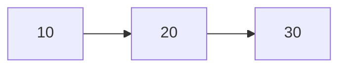

# Module 3 - `List` ADT and `Linked List` Implementation

**ADT** - Abstract Data Type
- ADTs are conceptual models that define a set of operations and behaviors for a data structure

**List ADT Goals**
- `insert` - Done via front/back, at index, or at pointer
- `delete` - Done via front/back, at index, or at pointer
- `getData` - Done via front/back, at index or at pointer
- `isEmpty` 
- `size`
- **Store any necessary constructor, destructors, copy constructors, etc. so that it behaves like any basic variable**

The goal is to have every data structure behave like a fancy interface, but at a fundamental level act exactly the same as a basic data type! They should also behave like **templates** so that they can store anything (integers, pictures, imaginary numbers, etc.). We just want one generic data structure!

This is done via generics and templates!

There are two main implementations of a list
1. vector or array (store a list by allocating a chunk of data!)
2. linked list (allocate every element in a list separately and link them together via pointers or references)

Data structures can be best shown as diagrams, like the example below, which shows a linked list



In this example (shown above), the **head** is the **first node** in the linked list, and is in fact a **pointer** that points to the first node in the linked list. 

Similarly, the **tail** is the **last node** in the linked list and it points to **nothing** (null pointer)!

This means that our List ADT must contain
- `head` - a pointer to a `ListNode`

Intuitively, this also shows that the linked list that contains several nodes, which begin with the value `10`, where then points to the next node of the linked list with value `20`, and so on
- From a C++ standpoint, this means that our List ADT must chain nodes together via **pointers** - Each node contains its own data along with a **pointer** that points to the next node in the List!

This is shown in the code below, which represents a generic `ListNode`, `ListNode<T>`. In this `ListNode` representation, each `ListNode` holds a generic type of data notated as `T`

Additionally, there is a pointer to the next `ListNode` in the List along with a copy constructor that can be used to copy data into the List!

```
// List.h

#pragma once

template <typename T>
struct ListNode {
	T data;
	ListNode<T>* next;
	ListNode(const T& data) : data(data), next(nullptr) { }
}
```

## `insertAtFront`


The `.hpp` extension is used to define functionality of templates defined in a `.h`. It typically contains the full definitions of template functions, enabling the compiler to generate code for each type instantiation based on the defined type

One of the functions that a good List data structure must implement is `insertAtFront`, which as the name suggests inserts a node to the front of the List! 

To understand this better, lets use a concrete example, where `3` will be inserted at the front of the following List


1. In order to insert `3` at the front of the List, we need to create a new `ListNode` type! However, the data cannot get destroyed after the function ends because the List type needs to store this value for as long as it needs to
	1. Therefore, we must dynamically allocate this newly created `ListNode` via the heap, where we will receive a pointer to that data on the stack!
2. Once we dynamically allocate the new `ListNode`, we must reassign the `next` pointer to the head of the List because it will be inserted at the front!
	1. In other words, the pointer to the next node is no longer null, like it was when newly created. Now it will point to the `head`!
3. Make `head` point to the newly created `ListNode`

In C++, this is what the `insertAtFront` algorithm would look like

```
// List.hpp

#include "List.h"

/** Inserts data at the front of a List
  * Runtime: O(1)
 */
template <typename T>
void List<T>::insertAtFront(const T& data) {
	// Dynamically allocate the data to the heap
    ListNode<T>* newNode = new ListNode(data);

	// Reassign the next pointer to the head
    temp->next = head;

	// Reassign the head pointer to the newly created node
    head = newNode;
}
```

This algorithm has a runtime of $O(1)$, due to three simple operations and doesn't loop or scale through a list size!

Recall what `->` (arrow operator) does in C++. Its a nice operator that dereferences the pointer and then calls an attribute/method on that pointer! `temp->next` is the mere equivalent of `(*temp).next`

## `insert`

The previous algorithm only inserted nodes at the front of the List. However a more general insert algorithm is recommended to insert nodes in more places than just the front!

To solve this problem, the best thing to do is to create a `insert` algorithm that is able to insert data anywhere at a given index of the list. This is shown in our updated `LinkedList` ADT code below

```
// List.h

#pragma once

template <typename T>
struct ListNode {
	T data;
	ListNode<T>* next;
	ListNode(const T& data) : data(data), next(nullptr) { }
}

template <typename T>
class List {
private:
	ListNode<T>* head;

public:
	void insertAtFront(const T& data);
	void insert(const T& data, int index);
}
```

When the index is 0, `insert` would behave exactly how `insertAtFront` works

To understand this much trickier algorithm, we can use the same concrete List example from `insertAtFront`, with example function call `insert(3, 1)`

To make this call take place, we need to find the node at the first index and insert the newly created node before that. To do this, our insert algorithm must do two following steps

1. Allocate the given data onto the heap
2. Find the place to insert the newly created node (typically the code semantics are before)
	1. Therefore, we need a helper `find` function to return the node by reference at the given index. Our updated `LinkedList` ADT is represented in the code below

	```
	// List.h
	
	#pragma once
	
	template <typename T>
	struct ListNode {
		T data;
		ListNode<T>* next;
		ListNode(const T& data) : data(data), next(nullptr) { }
	}
	
	template <typename T>
	class List {
	private:
		ListNode<T>* head;

	public:
		void insertAtFront(const T& data);
		void insert(const T& data, int index);
		ListNode<T>*& find(int index);
	};
	```
### `find`

1. To implement `find`, it to return a `ListNode*&`, which is **a `ListNode` pointer by reference**
    1. Recall that with return type semantics in C++, returning just a `ListNode*` won't actually allow us to change the original `Listnode*`. Doing so will create a copy of the `ListNode*` and instead modify the **copy** instead of the original pointer. Therefore, we need to return a **reference** to the original pointer, which is a type `ListNode*&`
    2. Recall that `insertAtFront` changed our `head` member variable. Therefore, `head` needs to be the pointer pointing at the given index needed to be inserted
    3. Implement this **iteratively**. Implementing **recursively** will cause a **Stack Overflow Error**, where no more stack frames can be placed on the call stack, resulting in **stack memory overflow**
        1. Regardless, thinking about the recursive solution can still be a good thing to do
            1. When `index` == 0, we know that this is the `head` of the List, or simply the first node, otherwise we return a recursive function call, which subtracts the index by 1, and then passes in the next node of the List. This recursive algorithm is shown in the first code snippet below
        2. To implement find iteratively, we can follow a fixed algorithmic step
            1. Return the `head` ListNode if the index is `0`. We can do this because we know the `head` is always at index `0`
                1. Recall that this method returns a `ListNode*&`, which is a **pointer reference**. `head` is in fact a **reference to a pointer**! 
            2. Create a temporary `ListNode`, `curr` that is assigned to head. This represents the current node being referenced in the `LinkedList`
            3. Otherwise, loop till `x` is less than `index - 1`, and reassign `curr` to the next node in the `LinkedList`
            4. Then return `curr->next` because we know that once `x` becomes `index - 1`, we can stop and just return the a reference to the next node in the `LinkedList`, hence `curr->next`
                1. Recall that `curr` is a **copy** of head! We don't want to return a copy `ListNode*`, but rather a reference `ListNode*`, which is simply a type `ListNode*&`
                2. Therefore, we return `curr->next` and loop from `x` to `index - 1`, instead of looping from `x` to `index` and returning just `curr`
            5. This process is shown in the second code snippet below

The code below shows implementing `find` **recursively**
```
// List.hpp

#include "List.h"

// RECURSIVE IMPLEMENTATION OF FIND!

/** Finds the ListNode at the given index!
 *  Runtime: O(n)
 */
template <typename T>
ListNode*& List<T>::find(int index) {
    return find(index, head);
}

template <typename T>
ListNode*& List<T>::find(int index, ListNode*& head) {
	// we know that the head is always the starting point at index 0 of the list, so we can just simply return the head
	if(index == 0) { return head; }

	// Return a recursive method call passing in the next node and decrement the given index!
	return find(index - 1, head->next);
}
```

The code below shows implementing `find` **iteratively**
```
// List.hpp

#include "List.h"

// ITERATIVE IMPLEMENTATION OF FIND!

/** Finds the ListNode at the given index!
 *  Runtime: O(n)
 */
template <typename T>
ListNode<T>*& List<T>::find(int index) {
    // Return the head if the index is 0
    // We know that the first node in the list is always the head!
    if(index == 0) { 
        return head; 
    }
    
    // Create a copy pointer of the head to traverse through the list!
    ListNode<T>* curr = head;
    
    // Traverse through the list to find the node right before the given index
    int x = 0;
    while(x < index - 1) {
        curr = curr->next;
        x += 1;
    }
    
    // Return the next node in the list, since that matches the node at the given index
    return curr->next;
}
```

We can also update our current implementation of the `LinkedList` ADT

```
// List.h

#pragma once

template <typename T>
struct ListNode {
    T data; // the current data in the linked list
    ListNode<T>* next; // a pointer to the next node in the linked list
    ListNode(const T& data) : data(data), next(nullptr) { }
};

template<typename T>
class List {
private:
    ListNode<T>* head; // a pointer to the head of the linked list

public:
    void insertAtFront(const T& data);
    void insert(const T& data, int index);
    ListNode<T>*& find(int index);
};
```

Runtime for our `find` function is $O(n)$ because we have to traverse up to $n$ nodes in the `LinkedList` to find the node at the given `index`

Now that the `find` function has been coded, we can continue with finishing our `insert` function. Recall that this is a generic function, which will insert data into the `LinkedList` at a given index. Recall that this algorithm is done in three steps
1. Call `find` to find the `ListNode` at the given index
	1. Recall that `find` returns a reference of a pointer to a `ListNode`, written as a type `ListNode*&`
 2. Allocate the given data onto the heap
	 1. Returned pointer should not be a reference pointer! Make just a regular pointer
	 2. Recall that a reference pointer refers to an existing pointer! There is no existing pointer here, we make a new one when allocating onto the heap
 3. Make the newly created node point to the found `ListNode` at the given index
 4. Set the node found at the given index's pointer to the newly created node

This algorithm is shown in the code below

```
// List.hpp

#include "List.h"

/** Inserts data in the given index of a list
 *  Runtime: O(n)
 */
template <typename T>
void List<T>::insert(const T& data, int index) {
	// Call `find` to find the `ListNode` at the given index
	ListNode<T>*& nodeAtIndex = find(index);

	// Dynamically allocate the data to the heap
	ListNode<T>* newNode = new ListNode(data);

	// Reassign the next node of the newly created node to be the `ListNode` found at the given index
	newNode->next = nodeAtIndex;

	// Reassign the found `ListNode` at the given index's pointer to the newly created node from the given data
	nodeAtIndex = newNode;
}
```

`insert` has a $O(n)$ runtime, since it needs to traverse to the given position/index and then insert the newly created node of the given data

## `operator[]`

The next function our `LinkedList` ADT must have is the operator `[ ]`. Recall that in C++ we can operator overload with a function that changes the behavior of the `[ ]` operator. 

The brackets operator will behave very similarly to the `find` function, but rather return the `data` by reference that the `ListNode` at the given index contains. This updates our `LinkedList` class like this (shown below)

```
// List.h

#pragma once

template <typename T>
struct ListNode {
    T data; // the current data in the linked list
    ListNode<T>* next; // a pointer to the next node in the linked list
    ListNode(const T& data) : data(data), next(nullptr) { }
};

template<typename T>
class List {
private:
    ListNode<T>* head; // a pointer to the head of the linked list

public:
    void insertAtFront(const T& data);
    void insert(const T& data, int index);
    ListNode<T>*& find(int index);
    T& operator[](int index);
};
```

This algorithm, therefore, works very simple

1. Find the `ListNode` at the given index (we already did this with the `find` function!)
2. Return that `ListNode`'s data (Every `ListNode` instance holds its own data!)

And the code for this function is below

```
// List.hpp

#include "List.h"

/** Returns the data by reference of the `ListNode` at the given index 
 *	Runtime: O(n)
 */
template <typename T>
T& List<T>::operator[](int index) {
    // Call `find` to find the `ListNode` at the given index	
    ListNode<T>* loc = find(index);
    
    // Return the data that the `ListNode` at the given index holds
    return loc->data;
}
```

The runtime for `operator[]` is also $O(n)$ because it takes $n$ times to traverse through the list to find the `ListNode` at the given index to then return its data!

### `remove`

The next function is to remove data from our `LinkedList` at a given index. This updates our `LinkedList` class structure!

```
// List.h

#pragma once

template <typename T>
struct ListNode {
    T data; // the current data in the linked list
    ListNode<T>* next; // a pointer to the next node in the linked list
    ListNode(const T& data) : data(data), next(nullptr) { }
};

template<typename T>
class List {
private:
    ListNode<T>* head; // a pointer to the head of the linked list

public:
    void insertAtFront(const T& data);
    void insert(const T& data, int index);
    ListNode<T>*& find(int index);
    T& operator[](int index);
    T remove(int index);
};
```

The algorithm for this is once again simple

1. Find the `ListNode` at the given index, with our helper `find` function, lets call it `toRemove`
2. Create a `temp` `ListNode` containing the `ListNode` to be removed, lets call it `temp`
3. Create a variable containing `temp`'s `data`, can call this `val`
4. Set toRemove to the next `ListNode` in the `LinkedList`
5. delete the `temp` `ListNode` from memory (`temp` was what was removed)
6. return `val`

```
// List.hpp

#include "List.h"

/** Removes a `ListNode` by index and returns its associated data! 
 * 	Runtime: O(n)
 */
template <typename T>
T remove(int index) {
    // Find the `ListNode` to be removed
    ListNode<T>*& toRemove = find(index);
    
    // Create a temporary `ListNode` containing what should be removed
    ListNode<T>* temp = toRemove;
    
    // Create a `val` variable to store temp's data
    T val = temp->data;
    
    // Reassign `toRemove` to the next node in the `ListNode`
    toRemove = toRemove->next;
    
    // Delete `temp` from memory since we no longer need it
    delete temp;
    return val;
}
```

**A couple things about this algorithm**
- You need a pointer to the node you're removing so you can later delete it, which is what we call `toRemove`
- Creates a copy pointer to the node being removed called `temp`. We keep a separate reference so that we can return its data in the function
	- Without `temp`, once `toRemove = toRemove->next`, the previous node that `toRemove` stored is now lost
	- We need the original node that was stored in `toRemove` in order to be able to return the data that was removed from the `LinkedList`, which is why we store it in `temp!
- `delete temp`, ensures the memory allocated to `temp` is freed. We do this call because we know that the `LinkedList` no longer needs this `temp` `ListNode` (**`LinkedList` no longer needs to track it!**)

This wraps up the first implementation of a List, often referred to as a `LinkedList`
<!--stackedit_data:
eyJoaXN0b3J5IjpbLTExMTM4ODMwMDVdfQ==
-->